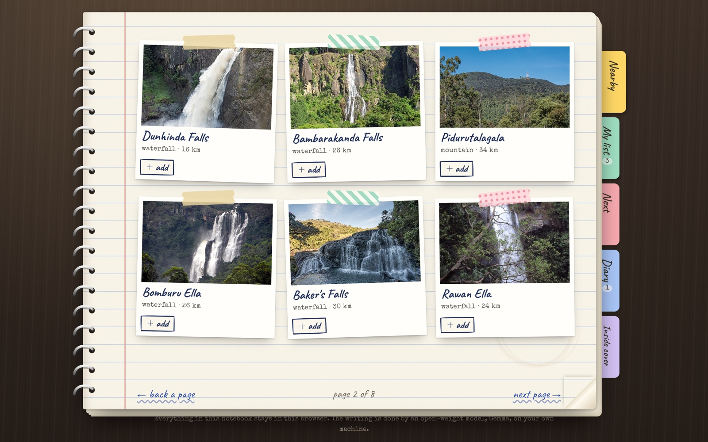
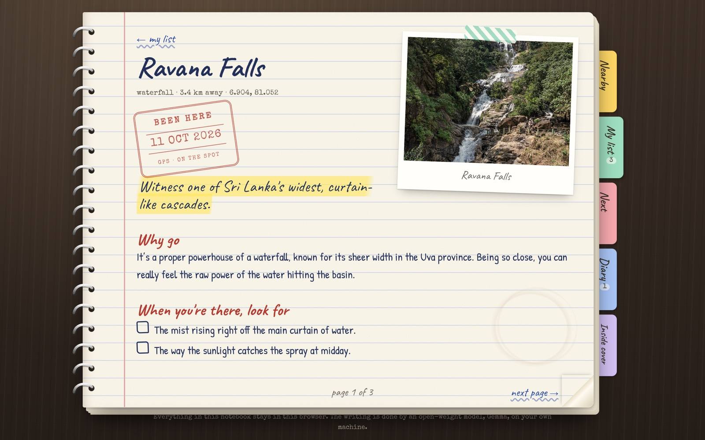
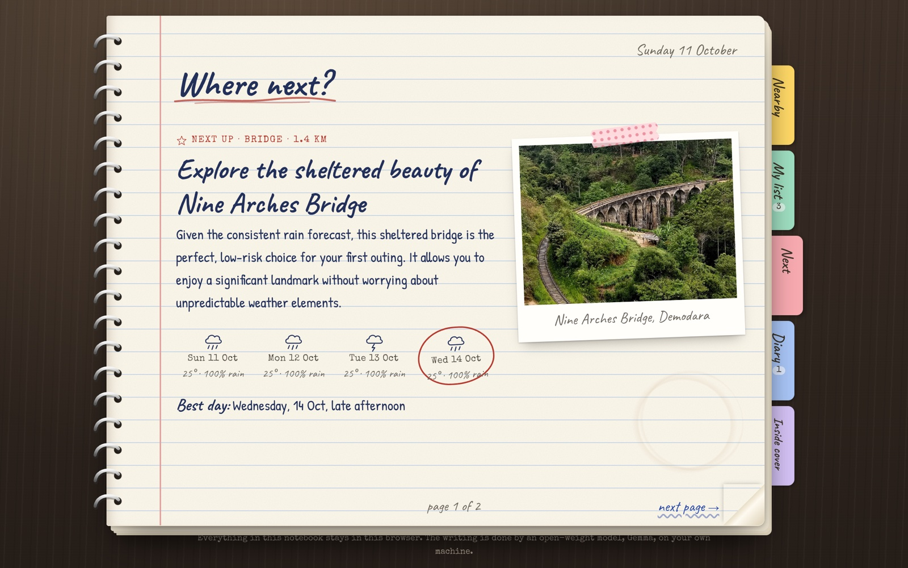
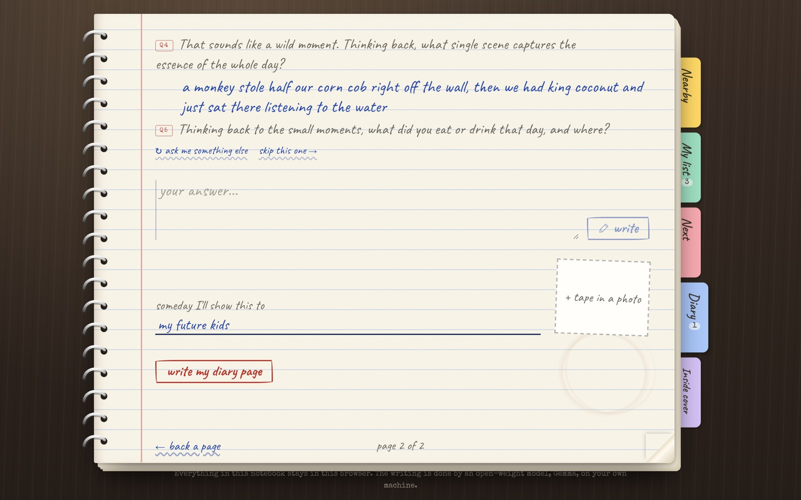
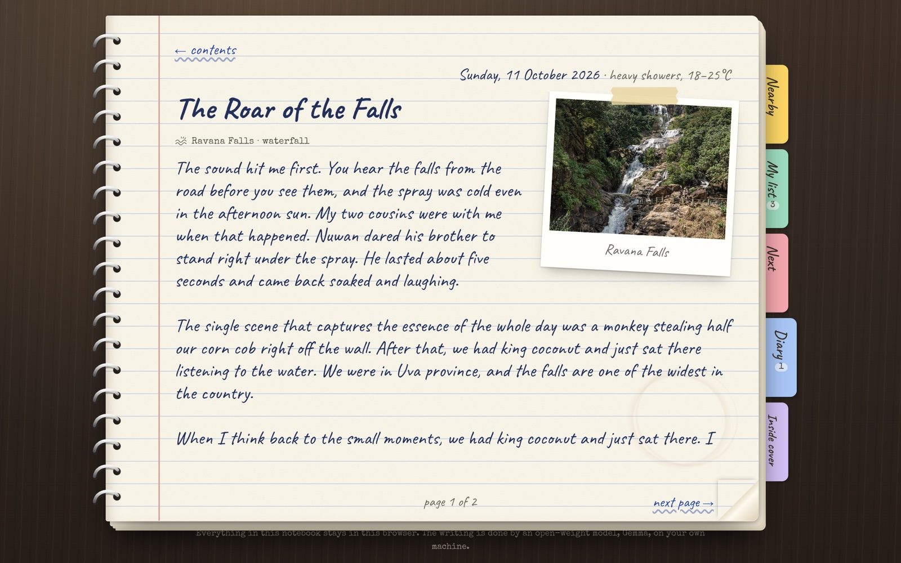

# Footnotes

**A paper-notebook bucket list for places you want to visit. It only fills up when you go outside.**



Footnotes looks and behaves like a spiral notebook: sticky-note tabs, ruled paper, taped polaroids, a coffee ring. The book fits your screen, laptop or phone, and pages turn instead of scrolling (next page, the dog-eared corner, the arrow keys, or a swipe). It:

1. **Finds beautiful places near you** (waterfalls, viewpoints, peaks, temples, old forts) from open data, ranked by how many Wikipedias bothered to write about them.
2. **Fills in each place's page.** An open-weight model (Gemma) writes why to go, three things to look for when you're there, the best time, practical tips, and one surprising fact. It's grounded in the Wikipedia extract, which is clipped onto the page.
3. **Suggests where to go next**, using your list, what you've already done, and the real 4-day forecast. A fixed rule keeps exposed places (peaks, falls, beaches, trails) off the menu in a stormy week, so the model can't send you up a mountain into a thunderstorm.
4. **Stamps your visit.** Press *I'm here!* on the spot and, if your GPS says you're actually there, the page gets a red "BEEN HERE" passport stamp. Otherwise you can add it from memory and get a blue stamp instead.
5. **Interviews you afterwards.** A voice in the margin interviews you with a plan: arriving, the people, the best moment, the senses, food, how it felt, advice, last words. Short answers get a follow-up; you can skip a topic, pick one, or ask for a different question. Then it turns your answers into a handwritten diary page, in your own voice, addressed to whoever you'll show it to someday.
6. **Hands the diary over.** *Show someone* opens the diary as a book with page turns, and prints to a keepsake PDF.

The diary only has pages for places you've actually been. The screen is just the part before and after.

## Why it's built on open pieces

The diary is personal: who you were with, what you felt, photos of your friends. So:

| What | Where it goes |
| --- | --- |
| Your diary chat, diary pages, photos, list | **This browser's IndexedDB. Nowhere else.** No account, no cloud copy, no analytics. *Download my notebook* gives you one JSON file you own. |
| The writing (place notes, next pick, interview, diary page) | **Gemma on your own machine** via Ollama (default), or **Gemma inside the browser tab** via WebLLM. The server keeps nothing. |
| Your location | Blurred to ~1 km (two decimals) before it reaches Wikidata, Wikipedia, OpenStreetMap Nominatim or Open-Meteo. |
| Photos | Fetched through the notebook's own server (`/api/img`, Wikimedia hosts only), so Wikimedia never sees your browser. |

Every piece is swappable: any Ollama model, any OpenAI-compatible host serving an open model, or no model at all. With no model, notes come straight from Wikipedia and your diary page is stitched from your own answers. The notebook never shows a blank page.

## Run it

```bash
ollama pull gemma4:e4b        # or gemma3:4b on smaller machines
npm install
cp .env.example .env.local
npm run dev
```

Open http://localhost:3000, write your name on the cover, open the notebook, and pick a starting point.

### Model options (`.env.local`)

```bash
# 1. Local (default, most private): Ollama on this computer
LLM_PROVIDER=ollama
LLM_BASE_URL=http://127.0.0.1:11434
LLM_MODEL=gemma4:e4b

# 2. Any OpenAI-compatible endpoint serving an open model (llama.cpp, vLLM, LM Studio, AI Studio Gemma)
# LLM_PROVIDER=openai
# LLM_BASE_URL=...
# LLM_MODEL=...
# LLM_API_KEY=...

# 3. Browser only: no server model; the notebook runs Gemma 2 2B in the tab with WebLLM
# LLM_PROVIDER=browser
```

`render.yaml` deploys option 3: the public copy has no model server at all, so nobody's diary ever reaches a machine they don't control.

## What's inside

```
src/lib/wiki.ts         Wikidata SPARQL "around me" + Wikipedia summaries, scored for beauty
src/lib/geo.ts          the Wikidata classes worth a notebook page, distance, the 1 km blur
src/lib/prompts.ts      every prompt, its parser, its no-model fallback, and the storm rule
src/lib/llm.ts          server side: Ollama or OpenAI-compatible, JSON + streaming
src/lib/browser-ai.ts   client side: Gemma 2 2B in WebLLM (WebGPU)
src/lib/ai.ts           one door to the model, wherever it runs
src/lib/store.ts        IndexedDB: places, diary pages, settings, export/import
src/components/         the notebook: cover, tabs, Nearby, list, place page, Next, diary interview, diary, inside cover
src/components/PagedSheet.tsx   a screen-sized page; content flows into page-sized columns
src/components/pageTurn.ts      the page turn: the sheet copied into five hinged, shaded strips
src/app/api/            places, place, img, geocode, weather, ai, health; all stateless
```

## Screenshots

| | |
|---|---|
|  |  |
|  |  |

The answers in the screenshots are demo text.

## Credits

- Places: [Wikidata](https://www.wikidata.org) (CC0). Notes and photos: [Wikipedia](https://en.wikipedia.org) and [Wikimedia Commons](https://commons.wikimedia.org) (CC BY-SA and file-specific licences).
- Geocoding: [OpenStreetMap Nominatim](https://nominatim.openstreetmap.org) (ODbL). Weather: [Open-Meteo](https://open-meteo.com) (CC BY 4.0).
- Models: [Gemma](https://ai.google.dev/gemma) via [Ollama](https://ollama.com) and [WebLLM](https://github.com/mlc-ai/web-llm).
- Fonts (self-hosted): Caveat and Patrick Hand (SIL OFL 1.1), Special Elite (Apache 2.0).

MIT licensed.
